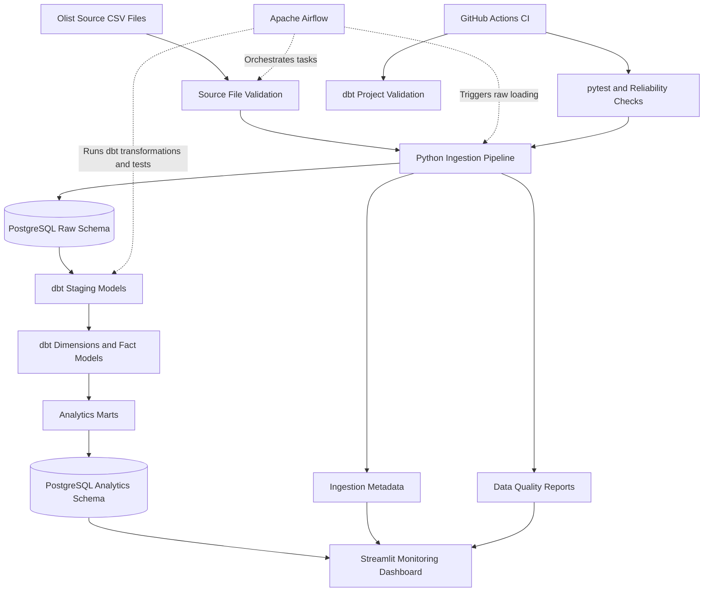

# DataPulse Architecture

## Overview

DataPulse is a batch data engineering platform built around the Brazilian E-Commerce Public Dataset by Olist. It ingests source CSV files, stores raw data in PostgreSQL, transforms data into analytics-ready models with dbt, orchestrates pipeline tasks with Apache Airflow, and provides monitoring through a Streamlit dashboard.

## Architecture Diagram

## Components

### 1. Source Data

The pipeline uses the Olist Brazilian E-Commerce Public Dataset. It contains customer, order, order item, payment, review, product, seller, geolocation, and product category translation data.

### 2. Python Ingestion

Python scripts validate source files, process CSV data with pandas, calculate content-based batch identifiers, and load records into PostgreSQL. The ingestion framework also maintains metadata and supports repeat-run protection for unchanged source files.

Main modules:

- `src/ingestion.py`
- `src/load_raw.py`
- `src/quality.py`
- `src/run_pipeline.py`
- `src/run_quality_checks.py`
- `src/validate_source_keys.py`

### 3. PostgreSQL Storage

PostgreSQL provides separate schemas for raw source data and transformed analytics models.

- `raw`: source tables and ingestion-related data.
- `analytics`: dbt-generated staging models, dimensions, facts, and marts.

### 4. dbt Transformation Layer

The dbt project transforms raw data into structured models suitable for analysis. Staging models standardize source data, dimension models organize descriptive entities, fact models represent transactional records, and marts provide business-level aggregations.

Project directory: `datapulse_dbt/`

### 5. Apache Airflow

Airflow orchestrates the pipeline through a DAG. Its tasks validate source files, load raw data, build the dbt warehouse, and test the resulting models.

DAG directory: `airflow/dags/`

### 6. Monitoring Dashboard

The Streamlit dashboard provides a user interface for reviewing sales metrics, warehouse row counts, corruption test results, and pipeline performance reports.

Application entry point: `dashboard/app.py`

### 7. Testing and CI

Python tests use pytest to check ingestion and data quality behavior. Additional reliability checks exercise selected failure scenarios, including duplicate replay and transaction rollback. Performance benchmarks record stage durations, exit statuses, and warehouse row counts.

GitHub Actions runs automated Python tests and dbt project validation.

## Data Flow

1. Source CSV files are checked before ingestion.
2. The Python pipeline loads source data into PostgreSQL.
3. Ingestion metadata and data quality reports provide operational evidence.
4. Airflow coordinates ingestion, dbt transformations, and dbt tests.
5. dbt builds analytics models in the PostgreSQL analytics schema.
6. The Streamlit dashboard reads analytics data and generated reports.
7. pytest and GitHub Actions provide automated validation.

## Configuration and Security

Database credentials are supplied through local environment configuration. The `.env` file must not be committed to version control. Production deployments should use managed secrets, appropriate database permissions, and secure network configuration.

## Limitations

This project is a portfolio-scale batch data platform. Its benchmark results depend on the local environment, dataset size, and whether unchanged batches are skipped. Synthetic corruption tests validate selected scenarios rather than every possible production failure. The local Docker and Airflow configuration should not be considered a production deployment without additional hardening.
